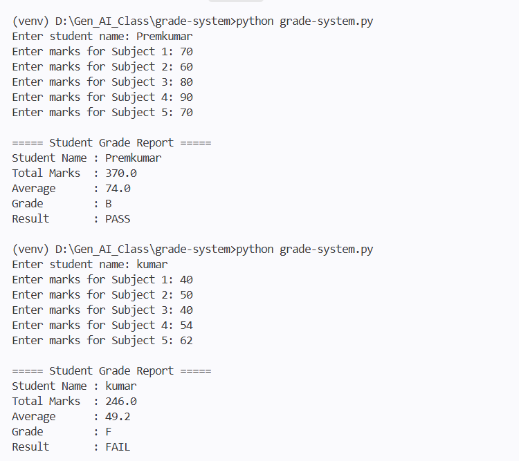

# Python Student Grade Calculator

A small command-line program that takes a student name and five subject marks, then prints the total, average and letter grade.

> Part of my Gen AI course practice work (Week 1, Day 2).

## Tech stack

- Python 3

## Features

- Reads student name and marks for 5 subjects
- Calculates total and average
- Maps the average to a grade (A+ for 90 and above, down to F)

## Getting started

1. Clone the repository:
   ```bash
   git clone https://github.com/Prembazskar/python-student-grade-calculator.git
   cd python-student-grade-calculator
   ```

## Usage

```bash
python grade-system.py
```

## Screenshots



## License

MIT, see [LICENSE](LICENSE).
